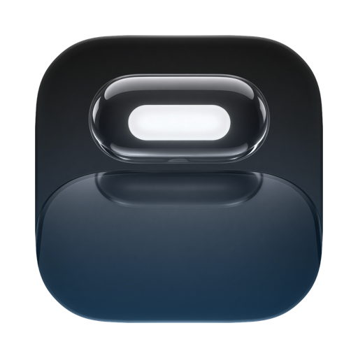

<div align="center">



# Tintpad

**It falls out of your notch.**

A free, open source macOS launcher for Claude Code and Codex.<br/>
Hotkey, repo, Return. Your terminal opens at that repo with the agent already running.

**[Download for macOS](https://github.com/sorkila/tintpad/releases/latest/download/Tintpad.dmg)**
&nbsp;·&nbsp; `brew install --cask sorkila/tap/tintpad`

[](https://github.com/sorkila/tintpad/actions/workflows/ci.yml)
&nbsp;[](https://github.com/sorkila/tintpad/releases/latest)
&nbsp;
&nbsp;

<a href="https://tintpad.com"></a>

</div>

---

## Install

**[Download Tintpad.dmg](https://github.com/sorkila/tintpad/releases/latest/download/Tintpad.dmg)**
(signed and notarized, macOS 14+), or the brew command above. Homebrew asks once to trust
the tap, say yes (`brew trust sorkila/tap` does it up front).

Or build it yourself (Swift 6, Xcode 16+):

```sh
git clone https://github.com/sorkila/tintpad.git && cd tintpad
swift run                  # dev run
./Scripts/package.sh       # Tintpad.app into .build/release
```

## Thirty seconds

1. Launch Tintpad. Setup asks where your repos live and which terminal is yours.
2. Press <kbd>⌥⌘Space</kbd> anywhere. The drop falls out of the notch with your repos inside.
3. Type a few letters, press <kbd>⏎</kbd>. Your terminal opens at that repo running what the two chips say.

You bring the agent: install `claude`, `codex` or any other agent CLI first.

## What it does

- **The drop.** Black on black, straight out of the housing. No notch? It hangs below the menu bar.
- **Your terminal, not a new one.** Ghostty, iTerm2, kitty, WezTerm, Alacritty, Terminal, or
  Warp, opened at the repo with the agent running. Warp has no command API, so it gets the
  repo and your clipboard gets the command.
- **The contract.** Two chips say exactly what Return runs, in the agent's own words. A mode
  that skips permissions turns red first and can ask before it fires, on every path.
- **Frecency.** The repos you actually use float up, with the agent and mode you used last.
- **Worktrees and dispatch.** <kbd>⌃W</kbd> for a fresh branch checkout with an agent inside,
  <kbd>⌃⏎</kbd> to run one in the background and get pinged when it's done.
- **Any agent.** Claude Code and Codex come set up. Anything else with a CLI is one line, see
  [Configure](#configure).
- **The rest.** Prompt library, per-repo presets, GitHub import, open in editor.
- **Polite.** Dynamic Type, VoiceOver, Reduce Motion. Local-only, no account, no telemetry.

It also fixes the quiet one: GUI apps don't inherit your shell `PATH`, so a double-clicked
app can't find `claude` at all. Tintpad reads your login shell once and moves on.

### If Return does nothing

Blame permissions. Launch problems show as a red line in the drop, and Return on that line
opens the right System Settings pane. If Accessibility says Tintpad is on but nothing
happens, macOS is holding a stale grant: remove Tintpad with the minus button, add it back,
relaunch.

## Keys

| Key | Action |
|---|---|
| <kbd>⌥⌘Space</kbd> | Summon (change in Settings → Keys) |
| <kbd>↑</kbd> <kbd>↓</kbd> | Move through your repos |
| <kbd>←</kbd> <kbd>→</kbd> | Move through your repos while the field is empty |
| <kbd>⏎</kbd> | Launch what the chips say |
| <kbd>⌘0</kbd> | Continue the last conversation |
| <kbd>⌘1</kbd>–<kbd>⌘9</kbd> | Jump straight to the nth repo and launch it |
| <kbd>⌘⏎</kbd> | Open repo in editor |
| <kbd>⌥⏎</kbd> | Launch the dangerous mode |
| <kbd>⇧⏎</kbd> | Launch the safest mode |
| <kbd>⌃⏎</kbd> | Headless dispatch |
| <kbd>⌃W</kbd> | New worktree |
| <kbd>⌃R</kbd> | Continue the conversation |
| <kbd>⇥</kbd> / <kbd>⇧⇥</kbd> | Cycle agent / mode |
| <kbd>⌘L</kbd> · <kbd>⌘P</kbd> | Inline prompt · cycle saved prompt |
| <kbd>⌘R</kbd> · <kbd>Esc</kbd> | Re-scan repos · close |
| <kbd>⌘,</kbd> | Settings |

Hold <kbd>⌘</kbd> for a beat and the drop shows each repo's number and each chip's key.
The menu bar's **Palette keys** menu and **Settings → Keys** list this table.

## Configure

Agents are just command templates with variables, set them in **Settings → Agents**:

```
claude {mode} {prompt}
```

Variables: `{repoPath}` `{repoName}` `{branch}` `{remote}` `{prompt}` `{mode}` `{shell}` `{worktreePath}`.
Every interpolated value is sanitized and shell-quoted before it runs.

## Contributing

PRs welcome, **especially new terminal adapters**, one protocol and one struct each. See [CONTRIBUTING.md](CONTRIBUTING.md) and [docs/ARCHITECTURE.md](docs/ARCHITECTURE.md).

## Pairs with

[Lockpaw](https://getlockpaw.com) is the other half of the loop. Tintpad starts your agents,
Lockpaw covers your screen while they run and glows when one needs you. Also free, also MIT.

## Support

Free and MIT, the whole thing. Nothing to unlock, no Pro version. If it saves you a
morning, [**sponsor it on GitHub →**](https://github.com/sponsors/sorkila)

## License

[MIT](LICENSE) © 2026 Erik Nielsen ([Sörkila](https://sorkila.com)).
